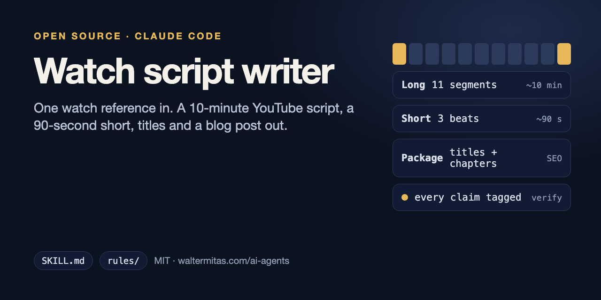

<p align="center"></p>

# Watch script writer: a Claude Code skill for YouTube watch videos

**A Claude Code skill that turns a watch reference into a full YouTube package: a retention-engineered 10-minute script, a 90-second short, titles and a companion blog article.**

 

Built for the [Brothers in Watches](https://brothersinwatches.com) channel, where every video is a single-watch showcase. The skill is plain Markdown that Claude Code follows. No code.

## What you get from one prompt

```
/watch-script Omega Speedmaster 3570.50
```

- **Retention map:** one master loop, 2-3 open loops closed in order, a contrarian beat.
- **Long video:** 11 segments with a narration column and a b-roll column, a micro-hook at every boundary.
- **Short cut:** about 90 seconds, hook first, one idea, the key number as the payoff.
- **Package:** 3-5 titles (brand first, 100 characters or fewer), description, chapters, pinned comment.
- **Blog:** a long-form "Deep Research Watch Report" built from the same research.
- **A `⚠️ verify` list** of every claim that needs confirming before you film.

## Why it works

The skill is deliberately thin. The rules live in `rules/`, so you change how every script sounds by editing one file:

| File | Job |
| --- | --- |
| `SKILL.md` | The pipeline: research, outline, draft, short, package, blog |
| `rules/style-guide.md` | Voice, retention rules, sourcing rules, titles, blog format |
| `rules/script-template.md` | The skeleton to fill, with per-segment word targets |
| `rules/validation-checklist.md` | Binary pass/fail checks the output must clear |

Two choices matter most:

1. **Facts are tagged, never invented.** Realized prices come first, asking prices are labelled, and anything uncertain is flagged `⚠️ verify`. An audience that knows watches punishes one bad claim.
2. **Retention is built in, not hoped for.** No preamble, a stated master loop, and a forward-pulling line at every transition.

## Install

Copy the folder into your skills directory:

```bash
git clone https://github.com/waltermitas/watch-script-skill.git
cp -r watch-script-skill ~/.claude/skills/watch-script
```

Then adapt `rules/style-guide.md` to your own channel's voice and brand.

## Example

See [`examples/omega-speedmaster-38-2026-short.md`](examples/omega-speedmaster-38-2026-short.md) for a finished short, including its fact ledger and verify list.

## FAQ

**Can AI write a YouTube script for a watch review?**
Yes, if it is held to a source-first process. This skill researches realized prices and the model's history, tags every claim by confidence, and flags anything it cannot verify instead of guessing.

**How long are the scripts?**
The long video is 2,200-2,600 words of narration (about 10 minutes) with a cold open of 60 words or fewer. The short is 220-260 spoken words (about 90 seconds).

**Does it work for other niches?**
The structure (master loop, open loops, micro-hooks, a short cut) is niche-independent. The horology vocabulary and sourcing rules live in `rules/style-guide.md`, so swap them for your own.

**Does it publish anything?**
No. It writes one Markdown file and reports back with the title options, the short and the verify list.

## Related projects

- [watch-hunter-skill](https://github.com/waltermitas/watch-hunter-skill): scheduled AI agents that hunt underpriced watches on ricardo.ch.
- [claude-agent-fleet-monitor](https://github.com/waltermitas/claude-agent-fleet-monitor): a dead-man switch for scheduled AI agents.
- [claude-seo-autopilot](https://github.com/waltermitas/claude-seo-autopilot): a three-runs-a-week SEO and AI search skill.

The full fleet, and what each AI agent got wrong, is at [waltermitas.com/ai-agents](https://waltermitas.com/ai-agents/).

## Licence

MIT
